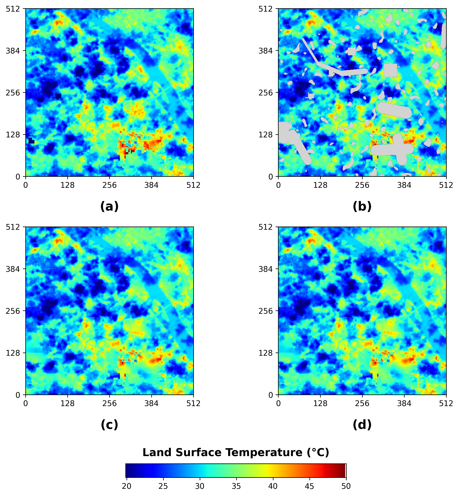
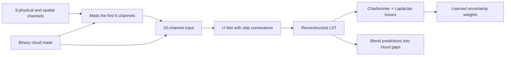

# PAWL-Net

**Physics-aware spatial inpainting with automatic loss weighting for cloud-obscured land surface temperature reconstruction.**

PAWL-Net reconstructs Landsat-8 land surface temperature (LST) using a ten-channel input, a U-Net backbone, and uncertainty-based weighting of Charbonnier and Laplacian edge losses. The study covers Can Tho, Long Xuyen, and Rach Gia in the Mekong River Delta, using 2015–2022 for training/validation and 2023–2024 for testing.

This repository organizes the research implementation, baselines, ablations, preprocessing, and analysis notebooks associated with:

> Gia Huy Le-Nguyen, Trung Nguyen Ly, and Nguyen Thai-Nghe. *PAWL-Net: A Physics-Aware Inpainting Network with Automatic Loss Weighting for Cloud-Obscured Land Surface Temperature Reconstruction.*

Author affiliations and ORCID identifiers are transcribed from the supplied manuscript in [the research notes](docs/research.md). Publication venue, year, and DOI are not specified in that document. See [CITATION.cff](CITATION.cff) for citation metadata. A source-code license has not yet been selected; see [usage rights](docs/usage_rights.md).

## Research overview



Historical notebook visualization of a 512 × 512 crop over Can Tho: (a) reference LST, (b) masked input, (c) PAWL-Net, and (d) Swin baseline. The image is preserved from the original notebook output; it was not regenerated during cleanup. See [figure provenance](docs/assets/README.md).



The physics-aware component consists of physical input features and their scaling. The implementation does not impose a heat-equation or radiative-transfer residual.

| Input | Channels |
| --- | --- |
| Thermal target/context | LST |
| Optical indices | NDVI, NDBI, MNDWI |
| Surface properties | Albedo, land surface emissivity |
| Spatial context | Distance to water, elevation, population density |
| Visibility | Binary mask: 0 = cloud, 1 = observed |

Under synthetic clouds, the first six channels are hidden; the three spatial channels remain available. The two-channel ablations use masked LST and the visibility mask.

## Reported results

The following values are **reported in manuscript Table 2**, rather than measurements produced by this repository cleanup. The manuscript describes 8,455 test patches of 128 × 128 pixels. Historical runs used different randomly generated masks; consult [reproducibility notes](docs/reproducibility.md) before interpreting comparisons or attempting to reproduce these numbers.

| Model | MAE (°C) ↓ | RMSE (°C) ↓ | R² ↑ | SSIM ↑ | Time (ms/patch) ↓ |
| --- | ---: | ---: | ---: | ---: | ---: |
| Random Forest | 5.3817 | 6.1559 | 0.0187 | 0.6086 | 392.02 |
| Swin-UNet baseline | 0.4852 | 1.2225 | 0.9617 | 0.9644 | 14.45 |
| **PAWL-Net** | **0.4504** | **1.1815** | **0.9641** | **0.9679** | **7.42** |

Timing is manuscript-reported on its stated hardware; it is not a portable performance guarantee. Machine-readable copies of Tables 2 and 3 are in [reports/](reports/).

## Repository layout

```text
configs/                 Portable experiment settings
src/pawl_net/            Dataset, masking, models, losses, training and evaluation
scripts/                 Command-line launchers and Earth Engine export
notebooks/               Data preparation and research analysis
tests/                   Data, model, metric and workflow regression tests
docs/                    Research, data, reproducibility and migration notes
reports/                 Manuscript tables and original result logs
data/raw/                Annual NumPy arrays, supplied separately
data/patches/{train,test}/ Local patch arrays, excluded from Git
data/archives/           Original data archives, excluded from Git
outputs/checkpoints/     Existing weights, excluded from Git
outputs/logs/            New run histories and evaluation JSON
outputs/figures/         Generated visualizations
```

Large data, weights, local environments, and local backups are excluded by `.gitignore`. They remain on disk. The manuscript PDF is not redistributed in the repository.

## Installation

Use Python 3.10 or later and a new environment. In PowerShell, from the repository root:

```powershell
python -m venv .venv
.\.venv\Scripts\Activate.ps1
python -m pip install --upgrade pip
python -m pip install -e ".[dev,notebooks]"
```

On Linux/macOS, activate with `source .venv/bin/activate`. For the Swin baseline, install `python -m pip install -e ".[swin]"`; for Earth Engine export, install `python -m pip install -e ".[gee]"`. Select a PyTorch build appropriate for your machine when using CUDA. The default device is selected automatically, and mixed precision is enabled only on CUDA.

## Data preparation

Read [docs/data.md](docs/data.md) for the array schema, data availability, and input-quality findings. The included local test archive was inspected during restructuring; its raw channel distribution and historical clipping behavior are documented for traceability. Training patches and the upstream Earth Engine asset-generation code are not included. The supplied local archive contains 324 zero-byte entries; these are preserved and reported by the loader instead of being replaced silently. Full test evaluation needs a complete data copy.

Place annual arrays named `City_YYYY.npy`, with shape `(12, H, W, 9)`, in `data/raw/`, then run:

```powershell
python scripts/prepare_patches.py
```

Years 2015–2022 are routed to training/validation patches and 2023–2024 to test patches. The default tile size is 128 and stride is 64. Within the training folder, the original sorted-file 80/20 split is retained. Overlapping patches can cross the internal train/validation boundary; this is documented rather than claimed to be a scene-disjoint split.

Paths in [configs/config.yaml](configs/config.yaml) resolve against `project_root`, relative to the YAML file. They do not depend on the shell's working directory. Copy it to `configs/config.local.yaml` for machine-specific paths; that filename is ignored by Git. Pass `--config configs/config.local.yaml` to use that copy; notebooks can pass the same path to `load_config()`.


## Train and evaluate

Run PAWL-Net training with:

```powershell
python scripts/train.py --experiment pawl --run-name pawl-01
```

New checkpoints go to `outputs/checkpoints/runs/pawl-01/`; existing research weights are preserved. Resume explicitly:

```powershell
python scripts/train.py --experiment pawl --run-name pawl-01 --resume outputs/checkpoints/runs/pawl-01/last_unet.pth
```

Evaluate the existing research checkpoint, or specify a checkpoint from a new run:

```powershell
python scripts/evaluate.py --experiment pawl --output outputs/logs/pawl-existing.json
python scripts/evaluate.py --experiment pawl --checkpoint outputs/checkpoints/runs/pawl-01/best_unet.pth --output outputs/logs/pawl-01-test.json
```

| Experiment selector | Architecture | Input channels | Objective | Existing best checkpoint |
| --- | --- | ---: | --- | --- |
| `pawl` | U-Net | 10 | AutoLoss | `best_unet.pth` |
| `swin` | Swin encoder + CNN decoder | 10 | AutoLoss | `best_model.pth` |
| `unet-2ch-l1` | U-Net | 2 | L1 | `best_2ch_l1.pth` |
| `unet-2ch-auto` | U-Net | 2 | AutoLoss | `best_2ch_auto.pth` |
| `unet-10ch-l1` | U-Net | 10 | L1 | `best_10ch_l1.pth` |

The Swin implementation is the supplied timm encoder with a convolutional decoder, not a pure Transformer decoder. Swin training may download pretrained encoder weights; evaluation uses `pretrained=False` before loading the selected checkpoint.

For Random Forest:

```powershell
python scripts/random_forest.py train --checkpoint outputs/checkpoints/runs/rf-01.joblib
python scripts/random_forest.py evaluate --checkpoint outputs/checkpoints/random_forest_model.joblib --output outputs/logs/rf-existing.json
```

Training intentionally retains the original **full-image loss**, epsilon `1e-6`, learning rate `2e-4`, 50 epochs, and patience 10. The manuscript describes several different settings. Cloud-only loss and optional mask-coverage limits are explicit configuration options, not a claim of exact manuscript reproduction. See [docs/reproducibility.md](docs/reproducibility.md).

Evaluation uses stable synthetic masks indexed by sorted patch order and seed. MAE, RMSE, and R² use hidden pixels; SSIM uses the whole patch after blending observed reference pixels and predicted cloud pixels, with a fixed 30 °C data range. Large pixel lists are replaced by streaming statistics. Source NoData still follows the historical clipping convention; this limitation must be resolved for a new scientific evaluation.

## Notebooks and development

- [Data preprocessing](notebooks/01_data_preprocessing.ipynb): export settings, temporal patch creation, and dataset inspection.
- [Analysis and inference](notebooks/02_analysis_and_inference.ipynb): cloud masks, channel visualization, scene reconstruction, NoData statistics, and inference timing.
- [Migration guide, in Vietnamese](docs/migration_vi.md): file moves, preserved local originals, and pre-existing Git issues.

```powershell
python -m pytest -q
ruff check .
ruff format --check .
```

The CI workflow runs code checks on synthetic fixtures without requiring research data, existing checkpoints, or Earth Engine access.

## Source-only archive

`python scripts/package_source.py` creates `dist/pawl-net-source.zip` with code, documentation, notebooks, directory READMEs, and a SHA-256 manifest. Local data, checkpoints, environments, backups, and Git history are excluded. This is a local packaging step and does not publish anything.
